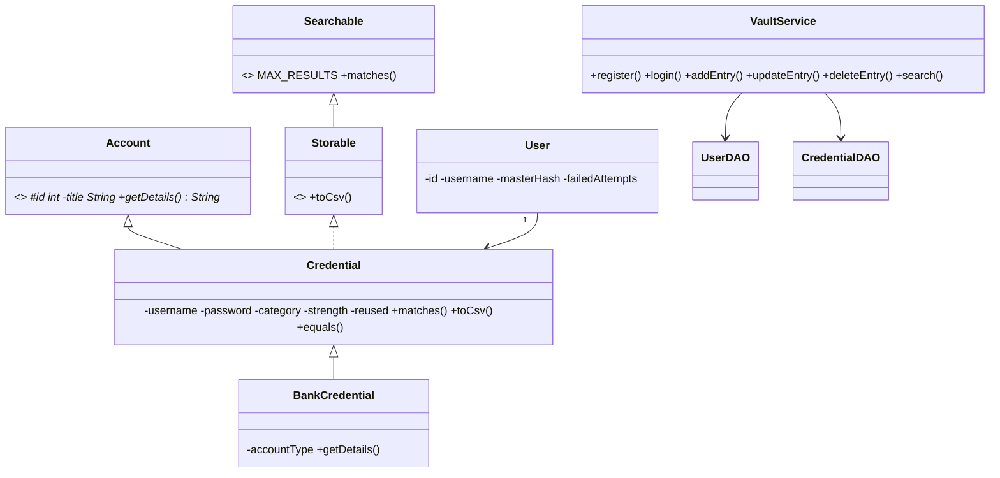
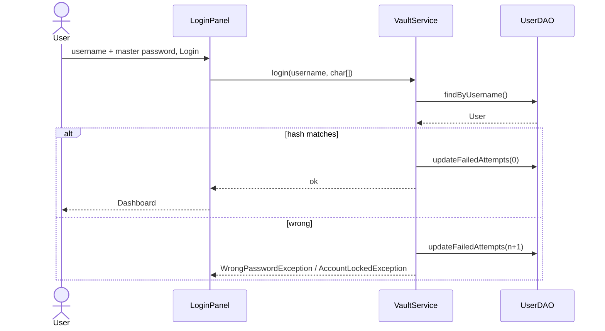
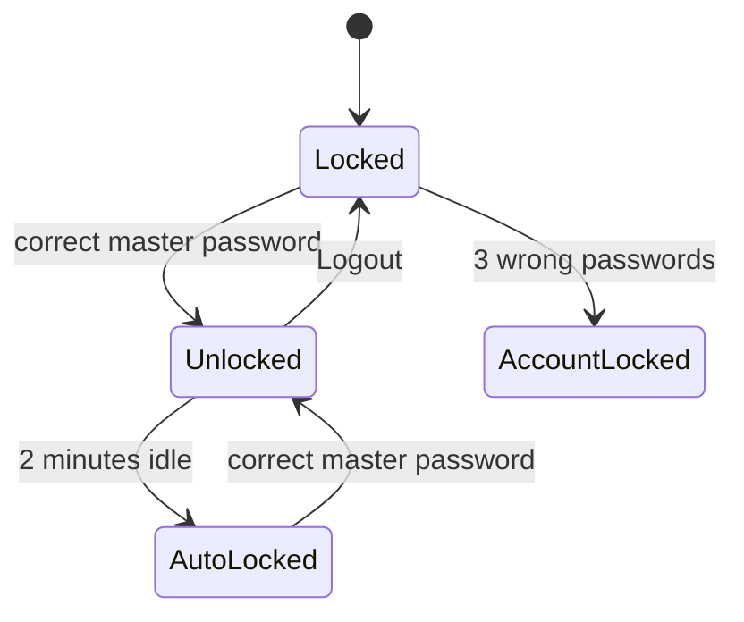

# SE Lab: problem statement, SRS, diagrams, tests

## Problem statement
Most people reuse the same 2 or 3 passwords everywhere and forget the rest. If one site leaks, everything is exposed.
CipherVault is a simple offline place to keep passwords behind one master password and see which ones are weak.

## SRS (short)
- **Actor:** User
- **Functional:** register, login (lock after 3 wrong tries), add / edit / delete / search entries, categories, generate
  a password, show strength, show / hide passwords, auto-lock after 2 minutes, import and export CSV.
- **Non-functional:** saved passwords are not stored as plain text; login takes under 2 seconds; runs on Windows and Linux
  (and macOS) with Java 17; works offline against a local MySQL.

## Diagrams (redraw these in StarUML for the lab; Mermaid below is the draft)

### Class diagram

### Sequence: login

### State chart

Use case, activity, collaboration, component and deployment diagrams follow the lists in the project document
(deployment: Java app on the user's PC connected to MySQL on the same machine).

## Test cases
- Unit tests T1 to T6 and the white-box branch test are in `src/test/java` (`StrengthCheckerTest`,
  `PasswordGeneratorTest`, ...). Run `mvn test`.
- Integration tests (TC_IT_*) need MySQL: `src/test/java/com/ciphervault/service/VaultServiceIT.java`.
- The full lab-format tables (TC_UT_01 to TC_IT_09) are in section 7 of the project document. The two failing cases there
  are fixed in code: search is case-insensitive (`Credential.matches` uses `toLowerCase()`), and failed attempts are saved
  to the database on every wrong login (`VaultService.login`), so a locked account stays locked after a restart.
